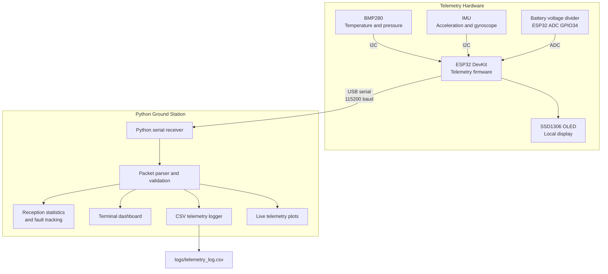

# System Architecture

## 1. Overview

The Satellite Telemetry System is an ESP32-based telemetry prototype that acquires sensor and battery measurements, displays selected values locally, and transmits structured telemetry packets to a computer over USB serial.

A Python ground station receives the packets, validates their structure and checksum, monitors packet reception, logs telemetry to CSV, and visualizes recent measurements.

The current implementation covers the sensor-to-computer telemetry pipeline. Satellite communication, LoRa transmission, and flight-qualified operation are not part of the documented current implementation.

## 2. Architecture Diagram



## 3. Hardware Layer

### 3.1 ESP32 DevKit

The ESP32 acts as the main controller. Its firmware reads the configured sensors, obtains the battery-voltage measurement, updates the OLED, and constructs telemetry packets for serial transmission.

### 3.2 BMP280

The BMP280 supplies temperature and atmospheric-pressure measurements over I2C.

- I2C address: `0x76`
- SDA: GPIO21
- SCL: GPIO22

The values are transmitted in the telemetry packet as temperature in degrees Celsius and pressure in hectopascals.

### 3.3 IMU

The firmware reads accelerometer and gyroscope registers using MPU-6050-compatible register addresses.

- I2C address: `0x68`
- SDA: GPIO21
- SCL: GPIO22

The ground station plots three acceleration axes and three gyroscope axes. These values are raw counts, not calibrated physical units. The actual sensor identity, register configuration, and calibration require verification.

### 3.4 Battery Monitor

The battery voltage is measured through an external voltage divider connected to ESP32 GPIO34.

The firmware applies configured divider and correction values to calculate the voltage. These values must be calibrated against a reliable multimeter.

### 3.5 OLED Display

The SSD1306 OLED provides a local display for selected sensor readings.

- Resolution: 128 × 64
- I2C address: `0x3C`
- SDA: GPIO21
- SCL: GPIO22

## 4. Firmware Layer

The ESP32 firmware performs the following operations:

1. Initializes the configured sensor, display, and battery-monitor interfaces.
2. Reads temperature and pressure from the BMP280.
3. Reads acceleration and gyroscope registers from the IMU.
4. Measures the battery-divider input through the ADC.
5. Updates the local OLED display.
6. Constructs a telemetry packet containing a sequence number and sensor readings.
7. Calculates the packet's XOR checksum.
8. Transmits the newline-terminated packet over USB serial.

The current firmware emits a telemetry packet only when the IMU, BMP280, and battery-read functions all report success.

## 5. Communication Layer

The current connection between the ESP32 and the computer is USB serial.

| Parameter | Configuration |
|---|---|
| Physical connection | USB |
| Serial baud rate | 115200 |
| Packet encoding | Comma-separated text |
| Packet identifier | `AKTD` |
| Packet termination | Newline |
| Error-detection field | Two-digit uppercase hexadecimal XOR checksum |

The serial device is explicitly configured in the Python receiver. On Fedora, the device path may be found by running:

```bash
ls -l /dev/serial/by-id/
```

The configured path may need updating if the device name changes.

See [Telemetry Protocol and UART Communication](telemetry_protocol_and_uart_communication.md) for the packet definition and checksum details.

## 6. Python Ground Station

The ground station is divided into modules with separate responsibilities.

### 6.1 Serial Receiver

`ground_station/serial_receiver.py`

Opens the configured serial device, receives telemetry, and coordinates the ground-station components. It has retry handling for serial exceptions and periods without valid telemetry.

It does not automatically discover every possible serial device. The configured port may need manual updating.

### 6.2 Packet Parser

`ground_station/parser.py`

Parses incoming telemetry packets and validates the packet identifier, expected field count, checksum, and numeric values.

### 6.3 Fault Detection

`ground_station/faults.py`

Tracks packet sequence anomalies, including duplicate and out-of-order observations.

The wider ground-station statistics also report valid and invalid packets, runtime, reception rate, and sequence gaps.

### 6.4 Terminal Dashboard

`ground_station/dashboard.py`

Displays the latest parsed telemetry and reception information in the terminal.

### 6.5 CSV Logger

`ground_station/logger.py`

Appends timestamps and parsed telemetry values to:

```text
logs/telemetry_log.csv
```

The path is relative to the working directory. Run the receiver from the repository root to keep the output in the expected location.

### 6.6 Live Plotting

`ground_station/live_plot.py`

Plots the following telemetry signals:

- Temperature
- Atmospheric pressure
- Battery voltage
- Acceleration X, Y, and Z
- Gyroscope X, Y, and Z

The live plot maintains a bounded recent history of 100 points by default.

## 7. End-to-End Data Flow

1. The ESP32 acquires measurements from the configured sensors and battery-monitor circuit.
2. The firmware prepares a packet with a sequence number and telemetry values.
3. The firmware calculates the XOR checksum and sends the packet over USB serial.
4. The Python receiver reads the serial stream.
5. The parser validates the packet structure, checksum, and numeric fields.
6. Valid telemetry is made available to the dashboard, logger, and live plot.
7. Reception statistics and sequence monitoring provide information about packet reception and sequence anomalies.
8. The CSV logger appends parsed measurements for later inspection.

## 8. Testing and Validation

The Python ground-station test suite can be run from the repository root:

```bash
source .venv/bin/activate
python -m unittest discover -s ground_station -p 'test_*.py' -v
```

The latest previously reported run passed 27 tests. The result should be rechecked after code changes.

Software tests do not independently validate sensor accuracy, electrical safety, battery calibration, or long-duration hardware behavior.

## 9. Known Limitations

- Sudden battery-voltage and environmental-reading changes have been observed during live operation; the cause remains undetermined.
- IMU identity, scale factors, and calibration need verification.
- Serial-port selection is configured explicitly.
- The protocol uses newline-delimited text and an XOR checksum.
- Extended disconnect/reconnect, sensor-recovery, and long-duration tests remain necessary, currently woroking on the Windows Operating System Properly ( Required revision in Fedora).
- The system has not been validated for flight-critical or safety-critical use.

## 10. Future Work

Potential improvements include:

1. Investigating simultaneous changes in sensor and battery readings.
3. Verifying the IMU and converting raw counts into calibrated physical units.
4. Adding sensor plausibility checks and clearer error reporting.
5. Supporting configurable serial-port selection.
6. Testing long-duration logging and USB disconnect/reconnect recovery.
7. Adding integration tests using valid, malformed, and corrupted packets.
8. Measuring long-run packet reception and loss.
9. Extending the architecture only after the current telemetry pipeline is adequately validated.
